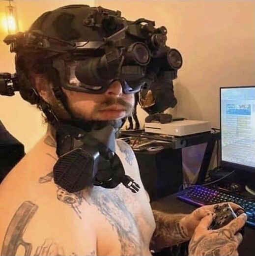
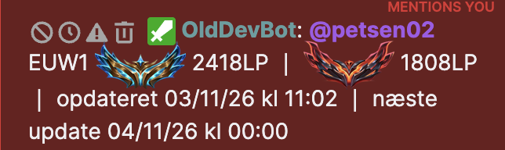

# LoL Twitch Bot (Lavet med AI)

Twitch-chatbot der viser League of Legends-rangdata for en liste af spillere,
via Riots officielle API.

> **Ansvarsfraskrivelse**
>
> LoL Twitch Bot is not endorsed by Riot Games and does not reflect the views
> or opinions of Riot Games or anyone officially involved in producing or
> managing Riot Games properties. Riot Games and all associated properties are
> trademarks or registered trademarks of Riot Games, Inc.

## Kommandoer

Hver kanal har sin egen spillerliste, main og region, så én bot kan betjene
flere streamere uden at de ser hinandens spillere.

| Kommando | Svar |
|---|---|
| `!rank [Navn#TAG]` | `RASMUS EMERALD IV: 2LP` — Master og opefter får også deres placering på ladderen, `(Rank#167)` |
| `!ranks` | Kanalens liste, nummereret, højeste først |
| `!gains` / `!session` `[Navn#TAG]` | `RASMUS: 3W 2L - (+24 LP) 🟩🟩🟥🟩🟥` for i dag. Er kampene ikke målt, udelades LP-feltet: `RASMUS: 3W 2L 🟩🟩🟥🟩🟥 │ måler fra næste kamp`. Ingen kampe i dag: `RASMUS: ingen data │ måler fra næste kamp` |
| `!nextrank [Navn#TAG]` | `Petsen SILVER II: 40LP │ mangler 8 wins til GOLD IV` |
| `!lastgame [Navn#TAG]` | Fuld statistiklinje for seneste ranked kamp |
| `!lobby [Navn#TAG]` | Gennemsnitsrank i den igangværende kamp, plus eventuelle pros |
| `!chal` / `!cutoff` | `EUW1 CHALLENGER 2418LP │ GRANDMASTER 1808LP │ opdateret 03/11/26 kl 00:00 │ næste update 04/11/26 kl 00:00` |

### LP-måling og watch-listen

Riot har ingen LP-historik — hverken i deres API eller nogen andre steder. Sider
som op.gg har den kun fordi de har målt selv i årevis. Botten gør det samme:
`src/tracker.js` aflæser hver fulgt spillers ladder-position og tilskriver
ændringen den ranked-kamp der skabte den.

Der er to lister over hvem der bliver målt, og de er med vilje adskilt:

- **Kanalens roster** (`data/channels.json`) er streamerens egen, kurateret af
  mods med `!oldaddplayer`. Den udløber aldrig og er det `!ranks` viser.
- **Bottens watch-liste** (`data/tracker.json`) er global og vores egen. Den
  får en spiller på sig automatisk, første gang nogen kører `!session Navn#TAG`
  på dem, og den dukker aldrig op i streamerens liste. Posten er permanent, og
  der er ingen vej af listen igen: er en spiller først set, bliver han målt
  hver dag fra nu af, uden at nogen skal huske at spørge først.

Selve LP-databasen har altid været global: alt er nøglet på `puuid`, ikke på
kanal. Er en spiller først målt ét sted, er tallene rigtige i alle kanaler.

### Hvor dataene ligger

Botten vælger selv lager ved opstart og skriver hvad den valgte i loggen:

| Node | Lager | Historik |
|---|---|---|
| 22.5+ | `data/tracker.db` (SQLite) | ubegrænset |
| Ældre | `data/tracker.json` | 14 dage |

`node:sqlite` er indbygget i Node, så der er ingen pakke at installere og intet
at kompilere på serveren. Første opstart på en ny nok Node kopierer indholdet
af `tracker.json` ind i databasen og **lader JSON-filen ligge urørt** — slet
`tracker.db`, og botten er tilbage hvor den var.

Forskellen er ikke kun kapacitet. JSON-filen skrives helt om ved hver
poll-runde, så prisen vokser med mængden af historik, hvilket er grunden til
at den blev begænset til 14 dage. SQLite skriver kun de rækker der ændrede
sig, så den grænse falder bort.

### Hvor mange kan der være på listen

Loftet er Riot-nøglens rate limit, ikke diskplads. Hver fulgt konto koster 2
requests per poll — ét ladder-opslag og én matchliste:

| | Poll-interval | Per konto i timen |
|---|---|---|
| Spiller lige nu (< 45 min siden) | 60 s | 120 requests |
| Inaktiv | 600 s | 12 requests |

En personlig nøgle giver 100 requests per 2 minutter = 3.000 i timen. Det
rækker til omkring 250 inaktive konti hvis man bruger hele budgettet på det,
så **regn med 100–150** når der også skal være plads til kommandoer og til de
spillere der rent faktisk er i gang. En godkendt production-nøgle fra Riot
flytter loftet til titusindvis.

Skru på `IDLE_POLL_SECONDS` før noget andet: fordoble det, og der er plads til
dobbelt så mange konti, mod at en afsluttet kamp først tæller et par minutter
senere. Den næste grænse er `data/tracker.json` selv, som skrives helt om ved
hver poll-runde — den begynder at gøre ondt et sted i tusinderne, og der er en
rigtig database svaret.

Målingen kan ikke gå baglæns. En spiller der lige er kommet på listen, får
først et LP-tal fra sin **næste** kamp; dagens allerede spillede kampe tæller i
W/L og firkanterne, men ikke i LP'en. Indtil da udelades LP-feltet helt frem
for at vise spillerens nuværende stilling, som læses som en gevinst. Først dagen efter — hvor botten når at
sætte et nulpunkt før første kamp — dækker `(+24 LP)` hele dagen.

## Admin-kommandoer

Alt der styrer kanalens opsætning har præfikset `!old`, og er lukket for
almindelige seere.

`!oldleave` kan kun køres af kanalens ejer — moderatorer kan ikke smide botten
ud. Spillerlisten gemmes, så botten kan tilføjes igen uden at sætte noget op
på ny.

| Kommando | Hvem | Virkning |
|---|---|---|
| `!oldcommands` | alle | Linker hertil |
| `!oldplayerlist` | mod | Viser kanalens spillerliste |
| `!oldaddplayer Navn#TAG` | mod | Tilføjer til listen, efter at kontoen er slået op hos Riot |
| `!oldremoveplayer Navn#TAG` | mod | Fjerner fra listen |
| `!oldaddmain Navn#TAG` | mod | Sætter main, og tilføjer til listen hvis den mangler |
| `!oldremovemain Navn#TAG` | mod | Fjerner main |
| `!oldregion euw1` | mod | Sætter kanalens region |
| `!oldleave` | kanalejer | Fjerner botten fra kanalen |

## Rang-ikoner med 7TV

Botten skriver tier-navnet som et almindeligt ord — `CHALLENGER`, `EMERALD` —
og 7TV bytter det ud med et ikon hos dem der har udvidelsen installeret.



### Sådan får din kanal ikonerne

**1. Hent emotes** fra [dette 7TV-sæt](https://7tv.app/users/01HMPER1EG00070FCM1Q64R22S)
og tilføj dem til din kanals emote set.

**2. Navnene skal være præcis disse**, med store bogstaver — 7TV skelner, så
`Emerald` og `EMERALD` er to forskellige emotes:

```
IRON  BRONZE  SILVER  GOLD  PLATINUM  EMERALD  DIAMOND  MASTER  GRANDMASTER  CHALLENGER
```

Mangler én af dem, skriver botten bare tier-navnet som tekst på den linje,
mens de øvrige viser ikoner.

**3. Seerne skal have 7TV installeret** — [browserudvidelsen](https://7tv.app)
findes til Chrome og Firefox. Uden den ser de `CHALLENGER 2418LP` som ren
tekst, hvilket stadig læses fint. Der findes ingen måde at sende billeder til
alle i en Twitch-chat.

Vil du helt undgå ikonerne, sættes `RANK_STYLE=letters` i `.env`. Så skriver
botten `C2418LP` i stedet.

## Regioner

Koden du skriver til `!oldregion`, og hvilken server den dækker. Riots egne
navne, bekræftet mod deres status-API.

| Kode | Server |
|---|---|
| `euw1` | EU West |
| `eun1` | EU Nordic & East |
| `tr1` | Tyrkiet |
| `ru` | Rusland |
| `me1` | Mellemøsten og Nordafrika |
| `na1` | Nordamerika |
| `br1` | Brasilien |
| `la1` | Latinamerika Nord |
| `la2` | Latinamerika Syd |
| `kr` | Korea |
| `jp1` | Japan |
| `oc1` | Oceanien |
| `sg2` | Singapore |
| `tw2` | Taiwan |
| `vn2` | Vietnam |

Filippinerne og Thailand har ikke længere egne servere — de er lagt ind under
Singapore.

`!oldregion` uden argument viser kanalens nuværende region og hele listen.

## Datakilder

- Rank, kampe og live-kampe: [Riot Games API](https://developer.riotgames.com/apis)
- Championnavne: Data Dragon
- Pro-spillere: [lolpros.gg](https://lolpros.gg) — udokumenteret internt
  endpoint, så `!lobby` falder tilbage til kun gennemsnitsrank hvis det ændrer
  sig. Deaktiveres ikke separat.
